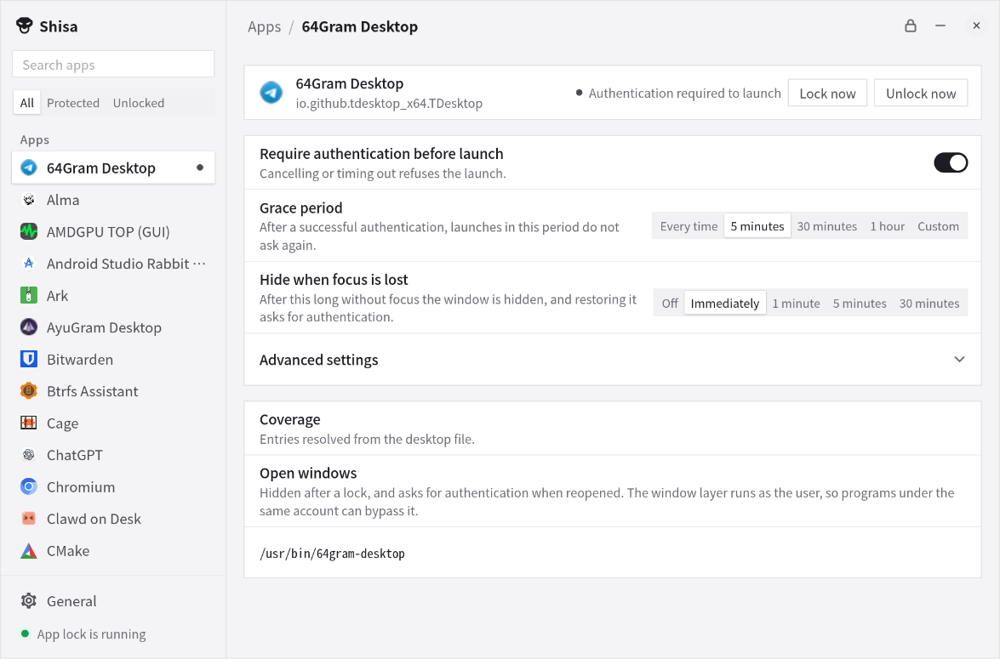

# Shisa

[](https://github.com/RiverOnVenus/Shisa/actions/workflows/test.yml)

English · [简体中文](README.zh-CN.md)

Shisa is an app lock for Arch Linux and KDE Plasma 6 on Wayland. Its main use is briefly lending your unlocked desktop: hide private windows such as chat and mail, then require a separate app-lock password to restore them or launch their apps again through a protected entry point.

Shisa is not a screen lock and not a user isolation tool.



## Installation

Download the x86_64 Arch package from [GitHub Releases](https://github.com/RiverOnVenus/Shisa/releases), or [build a local test package](docs/packaging.md#build-a-local-test-package), then install it and complete the initial setup:

```sh
sudo pacman -U ./shisa-0.1.4-1-x86_64.pkg.tar.zst
sudo passwd shisa-lock
sudo systemctl enable --now shisad.service
systemctl --user enable --now shisa-agent.service
```

Replace the example package filename with the file you downloaded or built. The app-lock password is separate from your login password. After upgrading, restart both services and reopen the settings window.

## Usage

1. Open **Shisa Settings** and enable **Require authentication before launch** for the apps you want to protect.
2. Before lending your desktop, right-click the Shisa tray icon and choose **Lock all**. Check the notification to confirm the protected windows were hidden. It also reminds you to enable Do Not Disturb when that is off.
3. When you get your desktop back, left-click the tray icon, select an app in **Restore windows**, and authenticate. The original window and unsaved content are preserved.

You can bind `shisa lock` to a KDE keyboard shortcut or enable **Hide when focus is lost** per app.

## Protection scope

Shisa guards against casually opening private apps. Launch authentication covers only protected entry points that are active. Apps running under the same account can still read application data, which is not encrypted, or interfere with window hiding. Hiding covers windows only, so notifications from hidden apps still appear and the notification history can still be opened. The lock notification reminds you when Do Not Disturb is off, so enable it before lending the desktop.

See the [threat model](docs/architecture.md#threat-model) for the situations Shisa covers and the ones it does not.

## Development

Run `cargo test --workspace` to check the Rust workspace. To build the settings app, run `npm ci` and `npm run build` in `gui/shisa-settings`, then run `cargo build --release --features custom-protocol` in `gui/shisa-settings/src-tauri`.

See the [developer documentation](docs/README.md) for architecture, coding standards, and testing, and the [packaging guide](docs/packaging.md) for Arch builds and upgrade verification.

## License

Copyright (C) 2026 RiverOnVenus.

[GPL-3.0-or-later](LICENSE)
