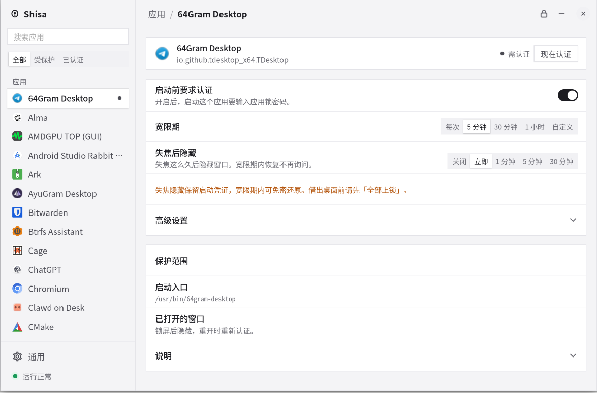

<p align="center">
  
</p>

# Shisa

[](https://github.com/RiverOnVenus/Shisa/actions/workflows/test.yml)

[English](README.md) · 简体中文

Shisa 是 Linux 上 KDE Plasma 6（Wayland）的应用锁。主要用于短时间把已解锁的桌面借给别人：收起聊天、邮件等私密窗口，之后要输入单独的应用锁密码，才能恢复窗口或从受保护的入口重新启动应用。

> **注意：** Shisa 不是屏幕锁，也不是用户隔离工具，它的作用很有限。它适合把已解锁的桌面短时间借给小孩、家人或朋友，或者暂时把私密窗口收起来。有心或懂技术的攻击者，以及任何知道登录密码的人，都可以绕过它。具体边界见[保护范围](#保护范围)。



## 安装

从 [GitHub Releases](https://github.com/RiverOnVenus/Shisa/releases) 下载对应发行版的包，或在 Arch Linux 上从 AUR 安装 `shisa`，或在本地[构建测试包](docs/packaging.md#build-a-local-test-package)，然后完成首次设置：

```sh
# Arch Linux（AUR）
paru -S shisa
# Arch Linux（发行包）
sudo pacman -U ./shisa-<version>-1-x86_64.pkg.tar.zst
# Fedora
sudo dnf install ./shisa-<version>-1.x86_64.rpm
# Debian 或 Ubuntu
sudo apt install ./shisa_<version>-1_amd64.deb

sudo passwd shisa-lock
sudo systemctl enable --now shisad.service
systemctl --user daemon-reload
systemctl --user enable --now shisa-agent.service
```

应用锁密码和登录密码是分开的。升级后重启这两个服务，再重新打开设置窗口。Fedora 和 Debian 包由 CI 构建，暂无真机 KDE 验收。

## 使用

1. 打开 **Shisa 设置**，给需要保护的应用开启「启动前要求认证」。
2. 借出电脑前，右键点击 Shisa 托盘图标，选择「锁定受保护应用」，再查看通知，确认受保护的窗口已收起。勿扰没开时，通知还会提醒你先开启。
3. 拿回电脑后，左键点击托盘图标，或从右键菜单选择「恢复窗口」，在面板里选择应用并认证。原窗口和其中未保存的内容都会保留。

可以在 KDE 快捷键设置中绑定 `shisa lock`，从键盘执行同样的手动上锁。「失焦后隐藏」是另一项便利功能：窗口失焦后收起，但保留应用的启动凭证，所以宽限期内恢复不会再询问应用锁密码。借出桌面前请使用「锁定受保护应用」，「失焦后隐藏」不能替代它。

托盘里 Shisa 图标是一个圆环包着锁孔，圆环表示状态：

|                                   图标                                    | 颜色   | 状态                           |
| :-----------------------------------------------------------------------: | ------ | ------------------------------ |
|       | 绿色   | 没有隐藏窗口                   |
|      | 蓝色   | 有隐藏窗口，恢复需要应用锁密码 |
|  | 琥珀色 | 有隐藏应用，宽限期内可免密还原 |
|     | 红色   | shisad 离线                    |

tooltip 会说明有几个隐藏应用可以免密还原。

## 保护范围

启动认证只覆盖当前生效的保护入口，应用数据不加密，同一账号下的程序仍可读取数据，也可能干扰窗口隐藏。隐藏只管窗口，被隐藏的应用照常弹通知，通知历史也照常能打开。

各种情况下的防护边界见[威胁模型](docs/architecture.md#threat-model)。

## 开发

运行 `cargo test --workspace` 检查 Rust 工作区。构建设置程序时，先在 `gui/shisa-settings` 运行 `npm ci` 和 `npm run build`，再在 `gui/shisa-settings/src-tauri` 运行 `cargo build --release --features custom-protocol`。

架构、开发规范和测试方法见[开发文档](docs/README.md)。各发行版的构建与升级验证见[打包指南](docs/packaging.md)。

## 许可证

Copyright (C) 2026 RiverOnVenus。

[GPL-3.0-or-later](LICENSE)
