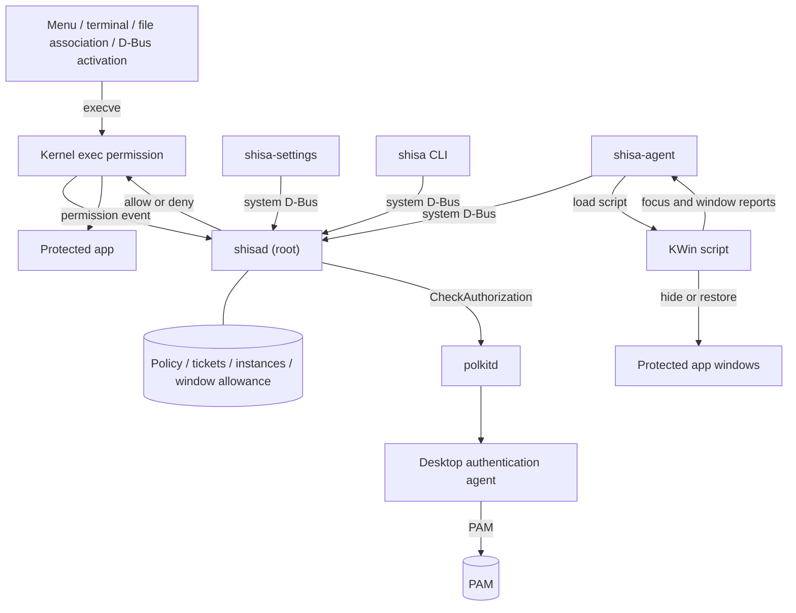

# Shisa architecture

## Scope

Shisa targets Arch Linux, KDE Plasma 6, Wayland, and systemd. Its primary use is briefly lending an unlocked desktop while keeping private apps out of casual reach. Use the screen lock when nobody needs the desktop and separate system accounts when people need isolated data. GNOME and X11 are outside the v1 scope.

Before lending the desktop, the owner selects Lock all. The daemon revokes launch tickets and window allowance. The session agent and KWin hide protected windows while leaving their processes running. The owner can later authenticate to restore an app. Apps can also be configured individually to hide on focus loss. That hide keeps the app's launch ticket, so restoring a window inside its grace period does not ask again.

Launch gating checks execution of protected inodes through menus, terminals, file associations, and other entry points. Window management handles already-open windows. Ticket expiry affects subsequent launches. Manual locking revokes both launch tickets and window allowance. Settings shows which paths are effectively protected.

## Design principles

1. Use the desktop polkit agent for authentication. The password passes from the agent to polkit's helper and stays outside shisad.
2. Make the launch decision at the kernel exec permission event. Every entry point that executes the same protected inode uses that decision.
3. Keep policy and tickets in a root-owned daemon. Changing the policy or stopping the daemon requires elevated privileges.
4. Leave desktop entries, application binaries, processes, and the user's home directory untouched.
5. Resume authorized launches with the original arguments, environment, terminal, and cgroup.
6. Explain refusals and provide a way to authenticate. Show the actual coverage for each app.

## Terminology

| Term                 | Meaning                                                                                   |
| -------------------- | ----------------------------------------------------------------------------------------- |
| App ID               | Desktop file ID without the `.desktop` suffix, such as `org.kde.dolphin`.                 |
| Protected app        | App selected in settings and identified by its app ID.                                    |
| Protected path       | Executable covered by an inode mark. An app can have several.                             |
| Launch ticket        | A time-limited authorization for one user and app, called `Ticket` in the code.           |
| Grace period         | A ticket's lifetime. Launches within it can reuse authorization.                          |
| Instance             | A running app admitted by the launch gate. The record lasts until its root process exits. |
| Authentication agent | The desktop polkit agent that displays the prompt and collects the password.              |
| Session agent        | `shisa-agent`, which runs in the graphical session and handles the tray and KWin.         |

## Architecture

| Component        | Runtime identity | Responsibility                                                              |
| ---------------- | ---------------- | --------------------------------------------------------------------------- |
| `shisad`         | Root             | fanotify decisions, policy, tickets, instances, polkit, and system-bus API. |
| `shisa-agent`    | User             | Tray, session state, and KWin script lifecycle.                             |
| `shisa-settings` | User             | Tauri and Svelte UI for app coverage and configuration.                     |
| `shisa`          | User             | CLI for status, locking, configuration, and terminal authentication.        |
| `shisa-core`     | Library          | Configuration, desktop entry and path resolution, shared D-Bus types.       |

## Threat model

| Situation                                                                                              | Coverage                                                                                                                                                                                                                                                                                                                                             |
| ------------------------------------------------------------------------------------------------------ | ---------------------------------------------------------------------------------------------------------------------------------------------------------------------------------------------------------------------------------------------------------------------------------------------------------------------------------------------------- |
| App menu, terminal, file association, D-Bus activation, or autostart                                   | Launch gating applies when the entry point executes a marked inode. Explicitly allowed autostart is exempt.                                                                                                                                                                                                                                          |
| Ordinary user attempts to stop shisad or change root-owned configuration                               | Requires elevated privileges.                                                                                                                                                                                                                                                                                                                        |
| Settings change during the launch grace period                                                         | Requires separate polkit authorization.                                                                                                                                                                                                                                                                                                              |
| Further settings changes from a window that authenticated recently                                     | The change authorization is kept against the settings process for 300 seconds by default, so those changes do not ask for the app-lock password. A global lock or a screen lock tells the window to exit, which ends the decision, and a change from a window that did not exit is refused. Launch authentication and `Unlock` still ask every time. |
| A person knows the login password                                                                      | The separate app-lock password still applies. Root or usable elevation credentials can override protection.                                                                                                                                                                                                                                          |
| Already-open window                                                                                    | Manual locking, configured screen locking, or optional focus-loss hiding can conceal it. The script runs under the user's account.                                                                                                                                                                                                                   |
| Copied executable, direct invocation of a shared runtime, or reading a wrapper through its interpreter | These paths can avoid a protected inode's exec event.                                                                                                                                                                                                                                                                                                |
| Reading app data, root access, or offline disk access                                                  | Outside Shisa's protection scope.                                                                                                                                                                                                                                                                                                                    |
| Lookalike password prompt or same-account interference with KWin                                       | Same-account processes can imitate a prompt or modify window properties.                                                                                                                                                                                                                                                                             |
| shisad exits or crashes                                                                                | The kernel releases pending requests and removes marks. systemd restarts the daemon after a crash.                                                                                                                                                                                                                                                   |
| shisad hangs                                                                                           | Protected execs can stall until the systemd watchdog restarts the daemon.                                                                                                                                                                                                                                                                            |
| fanotify queue overflows                                                                               | The kernel may allow discarded permission events without a daemon decision.                                                                                                                                                                                                                                                                          |
| polkit unavailable                                                                                     | Requests that need authentication are refused.                                                                                                                                                                                                                                                                                                       |

## Subsystems

- [Launch gating](subsystems/launch-gate.md)
- [Authentication](subsystems/authentication.md)
- [Window management](subsystems/window-management.md)
- [Configuration and interfaces](subsystems/configuration.md)
