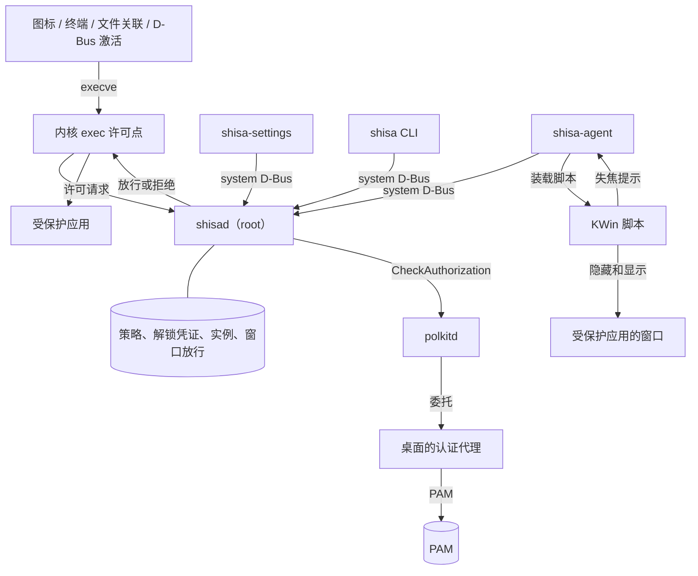

# Shisa 架构

## 定位与边界

Shisa 面向 Arch Linux、KDE Plasma 6、Wayland 和 systemd。首要场景是短时借用已经解锁的桌面。机主把电脑递给别人选照片或改文档时，希望对方能继续手头的工作，同时收起聊天、邮件等私人窗口，防止别人顺手点开。离席且无人需要使用桌面时，整机锁屏更直接。长期共用设备且需要隔离数据时，应使用独立系统账号。

借出前，机主从托盘执行「全部上锁」。shisad 清除该用户的启动凭证和窗口放行状态，会话代理与 KWin 负责隐藏受保护窗口，应用继续运行。拿回电脑后，机主可按需认证并恢复一个应用。失焦隐藏由用户按应用选用，适合希望切走后自动收起窗口的人。

启动和窗口两层都属于核心体验。启动层在受保护 inode 的 exec 许可点判断，覆盖实际执行该文件的菜单、终端、文件关联等入口。窗口层处理已经运行的应用。宽限期到期只影响下次启动，手动上锁会同时撤销两种放行状态。设置界面应让用户看得出应用的实际覆盖范围。

认证由桌面的 polkit 代理完成。独立的 `shisa-lock` 密码让知道登录密码的人也需要单独认证。保护范围限于应用入口和桌面窗口，同账号进程仍可读取数据或干预窗口层，有 root 权限或可用 sudo 凭据的人也可以停止服务。覆盖边界见下方威胁模型。GNOME 和 X11 不在 v1 范围内。

## 设计原则

1. 认证复用 polkit，不保存密码，不自己实现密码库，也不自己画认证框。密码只在桌面的认证代理和 polkit 的 helper 之间传递，不经过 shisad。
2. 判断发生在内核的 exec 许可点上，与入口无关。图标、终端、文件关联、D-Bus 激活走同一条路径。
3. 策略和解锁凭证放在 root 守护进程里，同账号的普通进程改不了，也停不掉它。
4. 不改写 .desktop，不注入应用进程，不修改应用二进制。Shisa 在用户目录里不留文件。
5. 应用以原本的参数、终端和 cgroup 启动。Shisa 只决定放不放行，不代为启动。
6. 被拦住时给出原因和认证入口。
7. 设置界面如实显示每个应用的覆盖情况，覆盖不到的不假装覆盖。

## 术语

| 术语       | 含义                                                                            |
| ---------- | ------------------------------------------------------------------------------- |
| 应用 id    | desktop 文件 id 去掉 `.desktop` 后缀，例如 `org.kde.dolphin`                    |
| 受保护应用 | 用户在设置里勾选的应用，用应用 id 标识                                          |
| 保护路径   | 一个受保护应用对应的可执行文件，可以有多个，按 inode 监视                       |
| 解锁凭证   | 一次成功认证的结果，按用户和应用记录，带过期时间。代码里叫 `Ticket`             |
| 宽限期     | 解锁凭证的有效期，期内再次启动不重复认证                                        |
| 实例       | 一份已放行、正在运行的应用。没有过期时间，根进程退出后移除                    |
| shisad     | root 守护进程，持有策略、解锁凭证和实例，回答 exec 许可请求，向 polkit 请求认证 |
| 认证代理   | 桌面自带的 polkit 代理，显示对话框、收集密码、执行 PAM                          |
| 会话代理   | `shisa-agent`，运行在用户会话里，显示托盘、接收状态变化                         |

## 架构

| 组件             | 语言                  | 运行身份 | 职责                                                        |
| ---------------- | --------------------- | -------- | ----------------------------------------------------------- |
| `shisad`         | Rust                  | root     | fanotify 许可判断、策略、解锁凭证、实例、polkit、system bus |
| `shisa-agent`    | Rust                  | 用户     | 注册、接收状态变化、托盘、装载窗口脚本                      |
| `shisa-settings` | Rust / Tauri + Svelte | 用户     | 设置界面，应用列表、宽限期、覆盖情况                        |
| `shisa`          | Rust                  | 用户     | 命令行，查状态、上锁、终端里认证                            |
| `shisa-core`     | Rust                  | -        | 配置、desktop 文件解析、保护路径解析、共享类型              |

## 威胁模型

| 场景                           | 结论               | 说明                                                                               |
| ------------------------------ | ------------------ | ---------------------------------------------------------------------------------- |
| 点图标、菜单、KRunner 启动     | 能防               | 最终都是 execve 保护路径                                                           |
| 终端直接运行                   | 能防               | 同上，没有延迟，应用不会闪现                                                       |
| 文件关联、D-Bus 激活、自启动   | 能防               | 同上                                                                               |
| 停掉 shisad 或改配置           | 能防               | 需要 root                                                                          |
| 知道登录密码并能取得 root      | 不能               | 直接用 sudo 停掉 shisad 或改配置                                                   |
| sudo 或 polkit 凭据缓存未过期  | 不能               | 已有提权凭据可能允许停止 shisad                         |
| 在设置里取消保护               | 能防               | 每项改动单独认证，解锁凭证不能代替，见[应用锁密码](subsystems/authentication.md#细节)                                         |
| 知道登录密码但不掌握 root 的人 | 设了应用锁密码能防 | 独立的应用锁密码由管理员设置，见[应用锁密码](subsystems/authentication.md#细节)                                               |
| 已经打开的窗口                 | 部分               | 手动上锁、锁屏或启用失焦隐藏时收起，窗口层以用户身份运行，见[窗口管理](subsystems/window-management.md)                                      |
| 复制二进制到别处运行           | 不能               | 新文件是新 inode                                                                   |
| 直接调用共享运行时             | 不能               | Electron 类应用只标记各自的包装脚本                                                |
| 用解释器直接读包装脚本         | 不能               | `sh 脚本` 不是 exec 打开，同上                                                     |
| 读取应用数据文件               | 不能               | 别的程序可以直接读，详见[启动拦截](subsystems/launch-gate.md)                                         |
| 伪造密码框                     | 有风险             | 同账号的程序可以画一个相似的窗口骗取密码，polkit 对话框也一样                      |
| shisad 崩溃                    | 保护失效           | 内核放行未回答的请求，systemd 重启后恢复                                           |
| shisad 挂死                    | 短暂卡住后同崩溃   | systemd 看门狗超时后重启                                                       |
| fanotify 队列溢出 | 保护可能失效 | 内核丢弃的许可事件无法由守护进程拒绝 |
| polkit 不可用 | 认证失败 | 需要认证的请求被拒绝 |
| 同账号修改窗口脚本或属性 | 无法阻止 | 窗口层在用户会话运行 |
| root 用户或离线读盘 | 无法阻止 | Shisa 不提供数据隔离 |

## 子系统

- [启动拦截](subsystems/launch-gate.md)
- [认证](subsystems/authentication.md)
- [窗口管理](subsystems/window-management.md)
- [配置与接口](subsystems/configuration.md)
