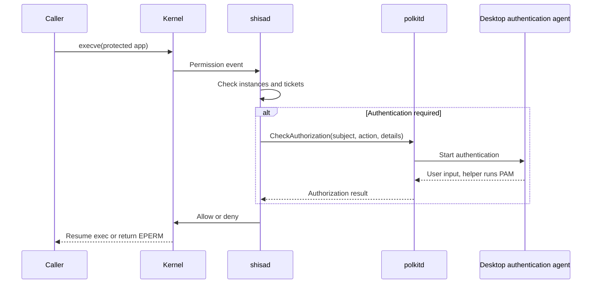

# Authentication

## Flow

## Policy and identity

shisad calls `CheckAuthorization` as root. The desktop agent prompts for the password, and polkit's helper hands it to PAM. Shisa has no password store or authentication UI.

Actions `io.github.RiverOnVenus.Shisa.launch` and `io.github.RiverOnVenus.Shisa.change` use `allow_active=auth_admin`, `allow_inactive=auth_admin`, and `allow_any=no`. The installed rule `49-shisa-admin.rules` selects `unix-user:shisa-lock` for those actions only. The administrator sets or changes its separate password with `sudo passwd shisa-lock`. The account starts locked and has no login shell or home directory.

Use `unix-process` with the pending exec caller's PID and start time for launches. Use `system-bus-name` with the caller's unique bus name for settings changes and `Unlock`. Avoid `unix-session` due to [polkit issue #699](https://github.com/polkit-org/polkit/issues/699). For processes in `user@.service`, polkit can find the user's graphical session by UID.

The prompt receives the app ID and display name, and the policy substitutes `$(app)` into the action message. Global changes use Shisa Settings as the display name. The desktop agent and compositor manage prompt focus. Alt+Tab can switch to it.

Each check is bound to a request ID. Launch authorization resumes the waiting execs and issues a ticket. Concurrent launches of the same app share one check. A settings authorization allows the requested change alone. Pending settings changes and explicit unlocks are limited to four per user and 32 globally. Launch checks use separate limits.

## Completion and cancellation

- Authorization resumes the pending operation. A prompt dismissal or a polkit refusal rejects it and records `denied`.
- The default wait is 60 seconds, configurable with `prompt_timeout_seconds`. On expiry the daemon rejects the operation and calls `CancelCheckAuthorization` on the same persistent bus connection that started it. Late approval cannot authorize the request. The activity record reports `timeout` or `cancelled`.
- A check error, including a bus error, rejects the request immediately and records `failed`.

The system PAM policy controls failure accounting. On systems using `pam_faillock`, incorrect passwords, cancellation, and timeout can count against the separate `shisa-lock` account. The threshold and lockout duration depend on the system.

When there is no graphical authentication agent, `shisa unlock <app-id>` can start `pkttyagent --process <its-pid>` for terminal authentication. Unlock applies only to protected apps. The ticket cannot authorize a settings change.

## Verification

See [Tests and verification](../testing.md) for integration tests and live prompt checks.

On 2026-11-17, the KDE agent prompted successfully. Authorization resumed the original launch and cancellation rejected it. With the graphical agent stopped, `shisa unlock org.kde.kwrite` in Konsole authenticated through `pkttyagent`. On the test system, `pam_faillock` counted cancellation and timeout against `shisa-lock` and left the login account unaffected.
