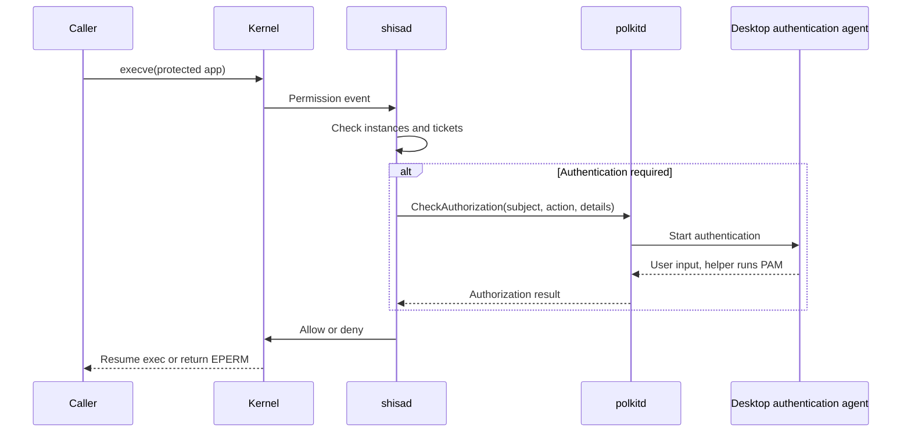

# Authentication

## Flow

## Policy and identity

shisad calls `CheckAuthorization` as root. The desktop agent prompts for the password, and polkit's helper hands it to PAM. Shisa has no password store or authentication UI.

Action `io.github.RiverOnVenus.Shisa.launch` uses `allow_active=auth_admin`, `allow_inactive=auth_admin`, and `allow_any=no`, so each launch authorization and each `Unlock` asks again. Action `io.github.RiverOnVenus.Shisa.change` uses `auth_admin_keep` for both. A successful change authorization is kept for the subject and action for `ExpirationSeconds` (300 seconds by default in `polkitd.conf`), so consecutive settings changes do not ask for the password again.

polkit converts the `system-bus-name` subject to the caller's `unix-process` (PID and start time) before it stores or looks up a retained change authorization. The decision therefore belongs to the settings process, not to one connection, and it is not tied to the request details, so it also covers a change to another app from the same window. polkit removes it when the process vanishes or the period expires.

The settings window calls `RegisterSettings` on its shared system-bus connection and watches for `SettingsLocked`. A global `Lock`, including Lock protected apps from the tray or the CLI, and a screen lock send that signal to the registered window, which exits. Exiting ends the process-keyed decision, so a desktop handed over after Lock protected apps cannot change protection without the app-lock password. A registered window whose change arrives after the lock is refused with `settings locked, reopen Shisa Settings`. The window snapshots `SettingsGeneration` before and after it subscribes and registers, so a lock in that gap exits it even though the daemon had no destination to signal. A second read that fails because the daemon vanished also exits it, since the replacement instance starts with an empty settings registry and cannot revoke the retained decision. If the window misses a later signal, the period still bounds the decision.

The settings window also watches the owner of the daemon's bus name. A daemon restart creates an empty settings registry, and the bus keeps this window's signal subscription alive across the owner change, so the window exits when the owner changes. That ends the process-keyed decision instead of leaving a window whose later changes a lock cannot refuse.

The installed rule `49-shisa-admin.rules` selects `unix-user:shisa-lock` for those actions only. The administrator sets or changes its separate password with `sudo passwd shisa-lock`. The account starts locked and has no login shell or home directory.

Use `unix-process` with the pending exec caller's PID and start time for launches. Use `system-bus-name` with the caller's unique bus name for settings changes and `Unlock`. Avoid `unix-session` due to [polkit issue #699](https://github.com/polkit-org/polkit/issues/699). For processes in `user@.service`, polkit can find the user's graphical session by UID.

The prompt receives the app ID and display name, and the policy substitutes `$(app)` into the action message. Global changes use Shisa Settings as the display name. The desktop agent and compositor manage prompt focus. Alt+Tab can switch to it.

Each check is bound to a request ID. Launch authorization resumes the waiting execs and issues a ticket. Concurrent launches of the same app share one check. A settings authorization applies the requested change alone. A later change from the same window and action can reuse polkit's retained decision. Pending settings changes and explicit unlocks are limited to four per user and 32 globally, and a request over either limit is refused before its event is queued. Launch checks use separate limits.

## Completion and cancellation

- Authorization resumes the pending operation. A prompt dismissal or a polkit refusal rejects it and records `denied`.
- A lock refuses an answer that was already on its way. Each held launch and explicit unlock records the user's and the app's lock generation when it starts. A global lock advances the user's generation, a single-app lock advances that app's, and a screen lock advances the user's launch generation only when it clears state. Settings changes also record a separate settings generation, which every global or screen lock advances even when launch tickets are kept. An answer that crosses the lock is refused, and a revoked held launch is denied. A settings change checks both generations and writes the file under the same mutex a lock takes, so the change either lands before the lock or not at all. The activity record reports `revoked` for a launch the lock denied.
- The default wait is 60 seconds, configurable with `prompt_timeout_seconds`. On expiry the daemon rejects the operation and calls `CancelCheckAuthorization` on the same persistent bus connection that started it. Late approval cannot authorize the request. The activity record reports `timeout` or `cancelled`.
- A check error, including a bus error, rejects the request immediately and records `failed`.

The system PAM policy controls failure accounting. On systems using `pam_faillock`, incorrect passwords, cancellation, and timeout can count against the separate `shisa-lock` account. The threshold and lockout duration depend on the system. On Arch, `pam_faillock` defaults to `deny=3` and `unlock_time=600`, so an untouched lockout ends after about ten minutes. To clear the count immediately, run `sudo faillock --user shisa-lock --reset`. The reset changes neither the password nor the login account.

When there is no graphical authentication agent, `shisa unlock <app-id>` can start `/usr/bin/pkttyagent --process <its-pid>` for terminal authentication. The absolute path keeps a user-writable directory earlier in PATH from supplying the helper, and Arch, Fedora, and Debian install it there. Unlock applies only to protected apps. The ticket cannot authorize a settings change.

## Verification

See [Tests and verification](../testing.md) for integration tests and live prompt checks.

On 2026-11-17, the KDE agent prompted successfully. Authorization resumed the original launch and cancellation rejected it. With the graphical agent stopped, `shisa unlock org.kde.kwrite` in Konsole authenticated through `pkttyagent`. On the test system, `pam_faillock` counted cancellation and timeout against `shisa-lock` and left the login account unaffected.

On 2026-11-22, the settings `change` action moved to `auth_admin_keep`. The settings window registers its connection and exits on `SettingsLocked`, which shisad sends after a global `Lock` and when every graphical session locks, and shisad refuses changes from a registered window after the lock. In the workspace, `cargo fmt --all -- --check`, `cargo test --workspace --locked` (178 tests, including `crates/shisad/tests/policy.rs` and the bus test for the global-lock signal, the screen-lock message and the refusal) and `cargo clippy --workspace --all-targets --locked` passed. In `gui/shisa-settings/src-tauri`, `cargo fmt -- --check`, `cargo test --locked` (5 tests), `cargo clippy --locked --all-targets` and `cargo build --locked --features custom-protocol` passed, and `bash -n tests/settings-manual.sh` and `xmllint --noout` accepted the script and policy.

On 2026-11-22, the user installed `shisa-0.1.4-1.1`, built from the `settings/polkit-keep` worktree, and verified the live cadence in the KDE Plasma Wayland session after restarting both services and reopening the settings window. The first settings change prompted once. Further changes within 300 seconds from the same window did not prompt. `Lock all` while the settings window was open closed the window, and reopening it and changing a setting prompted again. A screen lock also closed the window. Launching a protected app and restoring a window still prompted every time.

On 2026-11-26, the workspace tests passed the separate settings generation, global-lock invalidation, pre-queue 32/4 authentication limits, and the settings window's generation snapshot around signal subscription and registration. The virtual KWin and release package checks also passed. The sudo auth script then passed with 0 failed, covering refusal, one check per app group, the 5-second wait limit and cancellation, one check shared by two launches, ticket and lock behavior, and the window state. Three `shisa status` assertions in `tests/auth.sh` were updated from the earlier `open` and `lock` wording to the current `authorized` and `locked` wording. A live lock with an already-open authentication request was not run.
