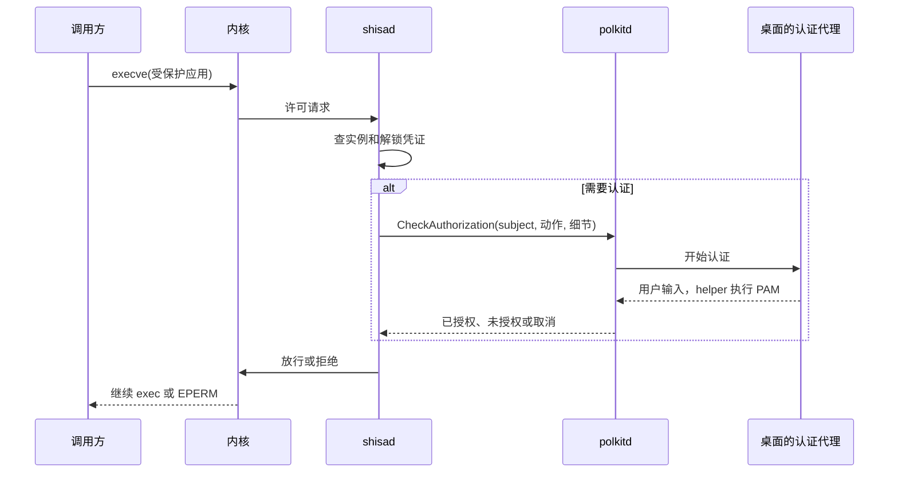

# 认证

## 流程

## 细节

- 认证由 polkit 完成。shisad 以 root 调 `CheckAuthorization`，密码在桌面的认证代理里输入，由 polkit 的 helper 交给 PAM。shisad 不接触密码，不实现密码界面，也不跑 PAM。
- polkit 动作是 `io.github.RiverOnVenus.Shisa.launch` 和 `io.github.RiverOnVenus.Shisa.change`。两者都是 `allow_active=auth_admin` 和 `allow_inactive=auth_admin`，`allow_any=no`。`/usr/share/polkit-1/rules.d/49-shisa-admin.rules` 只对这两个动作返回 `unix-user:shisa-lock`，其他动作继续走默认的 wheel 规则。所以对话框要的是单独的应用锁密码，不是登录密码。
- 应用锁密码由 root 用 `sudo passwd shisa-lock` 设置，Shisa 不保存它。账号不能登录，没有家目录和 shell。没设密码时账号是锁定的，认证会失败。改密码同样需要 root。
- subject 用 `unix-process` 或 `system-bus-name`，绝不用 `unix-session`。原因见 [polkit #699](https://github.com/polkit-org/polkit/issues/699)。启动请求用挂起 exec 的调用方 pid 和启动时间，设置改动和 `Unlock` 用调用方的唯一总线名。
- `user@.service` 里的进程没有登录会话，polkit 会按 uid 回退到该用户的图形会话，所以 Plasma 启动的应用也能找到 KDE 的代理。
- 细节里放应用显示名和 id。动作的 message 用 `$(app)` 代入，对话框写「打开 KWrite 需要验证身份」或「修改 KWrite 需要验证身份」。全局设置没有应用 id，代入的是「Shisa 设置」。
- 每次检查绑定一个请求号。授权通过只对这一个请求生效：启动请求放行被挂起的 exec 并发解锁凭证，设置请求只让那一项改动生效，不发解锁凭证。同一应用同时排着的启动请求合并成一次检查。
- 设置改动和 `Unlock` 同时等待的检查有上限，每个用户 4 个、全局 32 个，超出时直接返回错误。每个检查都要占线程和一条总线连接，本机进程可以发起这些调用，没有上限就能把 root 进程的资源耗光。启动请求的并发检查数由该用户受保护的应用数决定，不占这个名额。
- 等待上限是 `prompt_timeout_seconds`，默认 60 秒。到点后 shisad 调 `CancelCheckAuthorization`，代理的对话框随之关闭，请求被拒绝。迟到的“允许”按超时处理，不会放行。取消只对发起检查的那条总线连接有效，所以检查和取消都走 shisad 的常驻连接。
- 失败计数由系统的 PAM 策略维护。使用 `pam_faillock` 的系统可能把输错、取消和超时计入独立的 `shisa-lock` 账号。触发阈值和暂停时长由系统配置决定。
- 没有认证代理时，例如在 TTY 或 SSH 里，polkit 直接返回未授权。`shisa unlock <应用 id>` 自己启动 `pkttyagent --process <自己的 pid>`，在终端里完成认证。`unlock` 只对受保护的应用有效，解锁凭证只管启动，不能用来改设置。

## 对话框

对话框是桌面认证代理的普通窗口，不是 Shisa 画的。KDE 的代理显示标题「需要进行身份验证」、动作的 message、「正在作为 <用户> 进行身份验证」、密码框和详情、确认、取消。

对话框的焦点由桌面代理和合成器管理。用户可以用 Alt+Tab 切到它。

## 检查怎么结束

一条检查有这几种结束方式，互不依赖：

- 用户输入正确，polkit 返回已授权。
- 用户在对话框里点取消或按 Esc，polkit 返回未授权，请求被拒绝。活动记录写 `denied`。
- 等待上限到期，shisad 调 `CancelCheckAuthorization`，对话框关闭，请求被拒绝。活动记录写 `timeout` 或 `cancelled`。
- 检查本身出错，例如总线断开或 polkit 返回错误。请求立刻被拒绝，不必等到上限，活动记录写 `failed`。

代理自己的对话框和 PAM 对话由 polkit 管理，shisad 不启动也不结束任何界面进程。

## 验证

认证的集成测试和真实认证代理验收见[测试与验收](../testing.md)。

2026-11-17 在 Plasma 会话中验证了 KDE 认证代理正常弹窗、认证后原启动继续、取消后拒绝启动。关闭图形认证代理后，Konsole 中运行 `shisa unlock org.kde.kwrite` 仍可通过 `pkttyagent` 完成认证。使用 `pam_faillock` 的测试系统把取消和超时计入 `shisa-lock`，登录账号未受影响。
